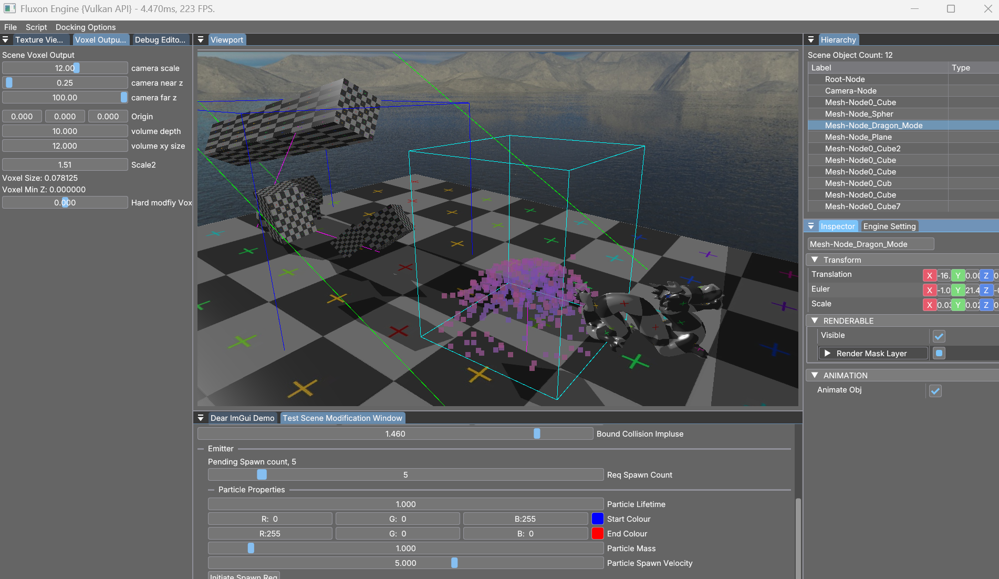

# Fluxon
An experimental C++ Vulkan project exploring real-time rendering, learning Vulkan, and GPU compute. Development is paused while
I focus on my primary project, the [Vortrix Physics Engine](https://github.com/Conqster/VortrixPhysics).

**Status: Incomplete/Paused**

## Project Status
Development ran from July 2025 to September 2025 and ended at the signed distance field (SDF) voxelisation stage: the engine can
rasterise scene geometry's SDF into a cube texture, which was designed as world collision data for GPU particles. 
The particle-collision integration that data was meant for was never wired up. The pause is deliberate; this project may be resumed
for further experimentation.

More [samples](#samples)

## Features
* Rendering
    * Multi-pass renderer: shadow mapping passes + Physically Based Rendering (PBR) forward shading pass
    * Renderable sorting via render bucket (`RenderPassBucket`)
    * SPIR-V shader pipeline - GLSL compiled via `glslc` on pre-build
      
* Compute & Simulation
  * GPU compute (`ComputePass`) driving particle simulation
  * SDF voxelisation pass (`ViewVoxelPass`) writing an SDF to a cube texture.

* Engine
  * Component-based scene graph
  * Editor tooling via ImGui.
  * Model loading via Assimp
  * YAML scene serialisation *(experimental - `USE_YAML` CMake option)*

## Future Prospects
* *Refactor project generation, configuration, and relative path includes*.
* **SDF Particle collision:** Synchronise the SDF cube texture with the compute particle kernel so particles collide against scene geometry.
* **Compute physics (long term):** Prototype Vulkan compute particle world for mesh destruction, cloth, hair etc,
* See more detail on the physics roadmap in [Vortrix Physics](https://github.com/Conqster/VortrixPhysics) Future Prospects.
### Project Status / Why Paused

## Samples
*Coming soon*

## Build Instruction
* **Operating System:** Window x64
* **Compiler:** Visual Studio 2022 (MSVC v143)
* **API Dependencies:** Vulkan SDK **(Note: The SDK path variable is currently pinned to `C:/VulkanSDK/1.4.313.2` inside `CMakeList.txt`. Update the local `Vulkan_SDK` directory pointer to match your install)**
* CMake 3.15+
* `cmake -S . -B build -G "Visual Studio 17 2022"` then build the `Fluxon` target
* Shader recompilation to SPIR-V automatically via a pre-build step (`assets/shaders/recompile_shader_to_spirv.bat`)
